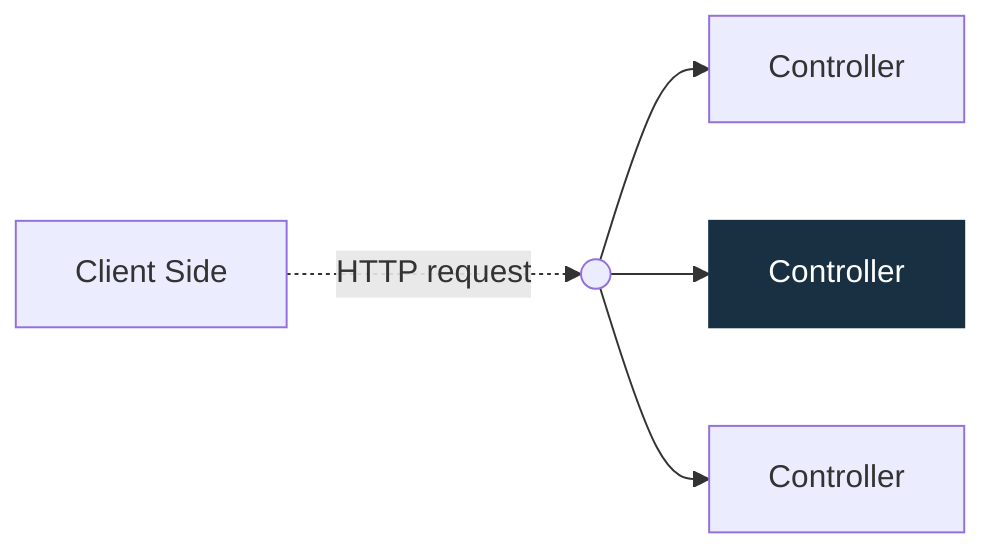
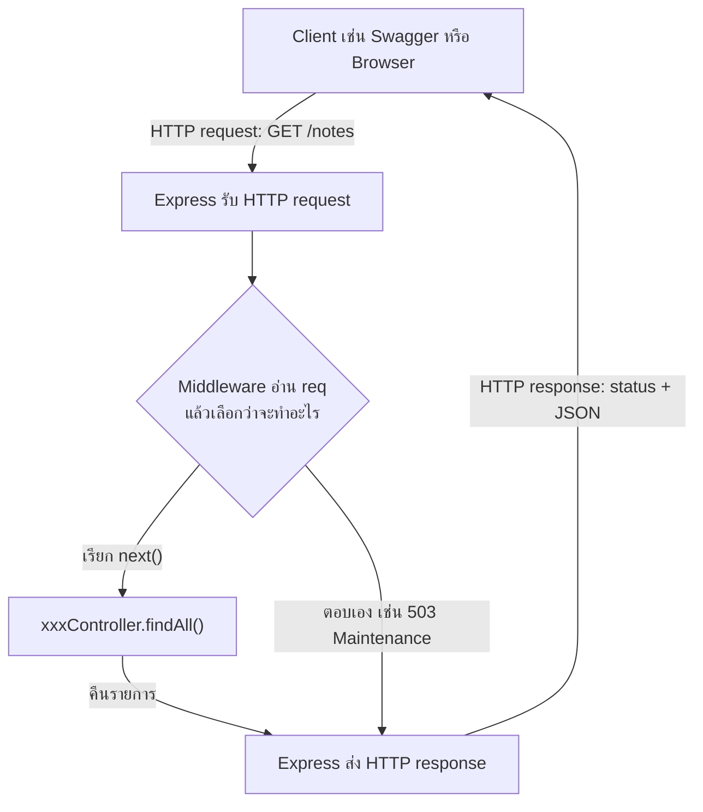

# [NestJS](https://docs.nestjs.com/first-steps)

เป็น framework สำหรับสร้าง backend บน nodeJS นิยมเขียนด้วย TypeScript ใช้ Express เป็นชั้นรับส่ง HTTP เป็นค่าเริ่มต้นและยังเลือกใช้ Fastify ได้ สาเหตุที่นิยมเขียน TypeScript เพราะว่า NestJS ถูกสร้างโดยภาษา TypeScipt เป็นหลัก

โดย NestJS ได้ผสมแนวคิดจาก OOP(Object Oriented Programming) FP(Function Programming) FRP(Function Reactive Programming) ดังนั้นการใช้แนวคิดการออกแบบ SOLID จึงเป็นเรื่องที่ดี และโครงสร้างของ NestJs ได้แรงบันไดจาก Angular

กรณีอยากเขียนเป็น JavaScript สามารถเขียนได้ แต่ต้องใช้ [Babel](https://babeljs.io) เข้ามาช่วยในการ compile เนื่องจากโครงสร้างหลักของ NestJS ส่วนใหญ่ใช้ TypeScript

# [Controller](https://docs.nestjs.com/controllers)
มีหน้าที่รับและจัดการคำขอ (request) จาก client แล้วส่งผลตอบกลับ (response) โดยระบบ Routing จะจับคู่ HTTP method และ path ของคำขอกับเมธอดใน Controller ที่รับผิดชอบ Controller หนึ่งตัวมีได้หลาย route และแต่ละ route ทำงานต่างกันได้

# [Providers](https://docs.nestjs.com/providers)

Provider คือสิ่งที่เราลงทะเบียนให้ NestJS จัดหาและส่งให้คลาสอื่นใช้ได้ เช่น Service หรือ Repository การที่คลาสระบุว่าต้องใช้อะไร แล้ว NestJS ส่งสิ่งนั้นให้ เรียกว่า **Dependency Injection (DI)**

- `xxxController` ต้องใช้ `xxxService` เพื่อจัดการคำขอ
- `xxxService` ต้องใช้ `xxxRepository` เพื่ออ่านและบันทึกข้อมูล

เมื่อเราลงทะเบียน `xxxService` และ `xxxRepository` ใน `providers` ของ `xxxModule` แล้วระบุสิ่งที่ต้องใช้ใน constructor แต่ละคลาส NestJS จะจัดการเชื่อมทั้งสามส่วนให้ตอนเริ่มแอป

# [Modules](https://docs.nestjs.com/modules)
Modules คือการกำหนดขอบเขตที่ NestJS ได้ทำการจัดระเบียบและโครงสร้างของ application โดยหลักๆ จะมี providers, controller, import, exports หมายความว่าเราจะไม่สามารถนำ provinders อีก modules มาใช้กับอีก modules ได้ 
แต่อย่างไรก็ตาม ยังมีสิ่งที่ต้องการใช้กับทุกๆ modules ได้ เช่น Helpers, Database ซี่งสามารถทำเป็น Global Modules เพื่อให้หลายๆ modules ใช้งานได้ด้วย แต่ไม่แนะนำให้ใช้ Global ทั้งหมด

# [Middleware](https://docs.nestjs.com/middleware)
คือสิ่งที่ทำงานร่วมกับ http request ก่อนถึง method controller และสามารถเข้าถึง object request หรือตอบ response ได้เอง ซึ่งของ nestJS เองสามารถเทียบเท่ากับ middleware ของ [Express](https://expressjs.com/en/guide/using-middleware/)

HTTP Adapter คือชั้นที่เชื่อม NestJS กับตัวรับส่ง HTTP โดย ExpressAdapter ใช้ Express, FastifyAdapter ใช้ Fastify และ NodeAdapter ใช้ node:http ที่มากับ Node.js โดยตรง ทั้งสามแบบยังรันบน Node.js เหมือนกัน
ดังนั้น โดยค่าเริ่มต้นจะใช้ ExpressAdapter เพราะเป็นตัวที่ทำงานได้รวดเร็วที่สุดในบรรดาทั้ง 3 ตัว โดยตรวจได้จาก [Performance](https://docs.nestjs.com/http/performance#performance)

ผลกับ Middleware คือ req และ res ที่ได้รับอาจต่างกันตาม adapter ที่เลือก NodeAdapter รองรับรูปแบบ use(req, res, next) และเมธอดสไตล์ Express เช่น res.status() และ res.json() ส่วน Middleware บน Fastify จะได้รับ req และ res ดิบของ Node.js จึงต้องเช็กก่อนใช้โค้ดที่อาศัยเมธอดของ Express