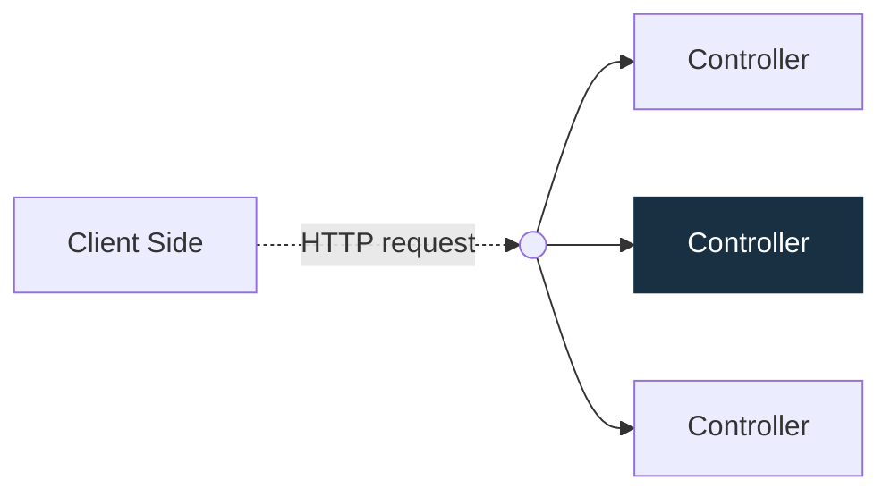

# [NestJS](https://docs.nestjs.com/first-steps)

เป็น framework สำหรับสร้าง backend บน nodeJS นิยมเขียนด้วย TypeScript ใช้ Express เป็นชั้นรับส่ง HTTP เป็นค่าเริ่มต้นและยังเลือกใช้ Fastify ได้ สาเหตุที่นิยมเขียน TypeScript เพราะว่า NestJS ถูกสร้างโดยภาษา TypeScipt เป็นหลัก

โดย NestJS ได้ผสมแนวคิดจาก OOP(Object Oriented Programming) FP(Function Programming) FRP(Function Reactive Programming) และโครงสร้างได้แรงบันไดจาก Angular

กรณีอยากเขียนเป็น JavaScript สามารถเขียนได้ แต่ต้องใช้ [Babel](https://babeljs.io) เข้ามาช่วยในการ compile เนื่องจากโครงสร้างหลักของ NestJS ส่วนใหญ่ใช้ TypeScript

# [Controller](https://docs.nestjs.com/controllers)
มีหน้าที่รับและจัดการคำขอ (request) จาก client แล้วส่งผลตอบกลับ (response) โดยระบบ Routing จะจับคู่ HTTP method และ path ของคำขอกับเมธอดใน Controller ที่รับผิดชอบ Controller หนึ่งตัวมีได้หลาย route และแต่ละ route ทำงานต่างกันได้

